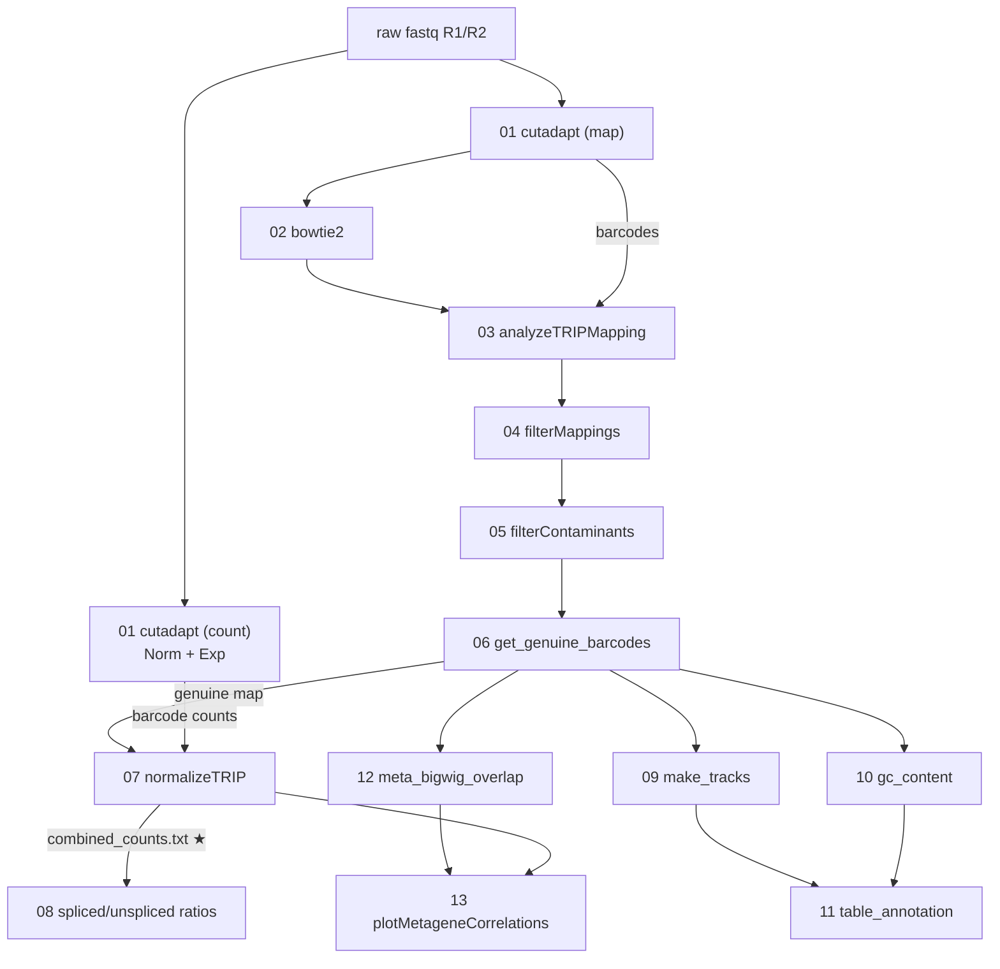

# SpliceTRIP

Processing pipeline for the TRIP (Thousands of Reporters Integrated in Parallel) data in:

> Nielsen M, Tyukaev A, Garkul L, Ulitsky I. **Genomic context tunes sequence-encoded RNA
> processing.**

It takes raw sequencing reads from a TRIP experiment and produces, for every barcoded reporter
integration, its genomic position, its RNA and DNA read counts in each library, and a genomic
annotation of the integration site. The configurations for the paper's Regular and PCPA
reporters, the eight IntronTRIP introns and the HaloSON experiment are included (see
"Datasets in the paper").

Raw and processed data are in GEO (the full library list is Table S10 of the paper). The
machine-learning analyses are in a separate repository,
[ArtyomTyukaev/trip-ml-part](https://github.com/ArtyomTyukaev/trip-ml-part).

## How a TRIP experiment is read out

A pool of reporter plasmids, each carrying a random 18-nt (16-nt for landing-pad
libraries) barcode, is integrated into the genome with piggyBac transposase, which inserts at
TTAA sites. Three kinds of sequencing libraries are made from the same cell pool:

| library | made from | what it gives | config section |
|---|---|---|---|
| **Map** | genomic DNA, DpnII digest + inverse PCR | which barcode sits at which genomic position | `### FASTQ_MAPS` |
| **Norm** | genomic DNA, barcode amplicon | how many copies of each barcode are in the pool | `### FASTQ_NORM` |
| **Exp** | cDNA, barcode amplicon (total, polyA, spliced, unspliced, ...) | how much RNA each barcode produced | `### FASTQ_SAMPLES` |

Stages 01-06 decide, per barcode, where it integrated and whether that call can be trusted.
Stage 07 joins each Exp library with its Norm library and the map, giving one row per
barcode. Stages 08-13 derive splicing ratios and annotate the integration sites.

## Pipeline

```
raw fastq (R1/R2)
 -> [01] cutadapt: barcode + UMI moved into the read header, adapters trimmed
 -> [02] bowtie2 alignment of Map reads to hg38                    (Map libraries only)
 -> [03] analyzeTRIPMapping: reads -> positions with their barcodes
 -> [04] filterMappings: merge near-duplicate positions (+ optional TTAA filter)
 -> [05] filterContaminants: remove cross-pool index-hopping
 -> [06] get_genuine_barcodes: one map per construct, single-position barcodes only
 -> [07] normalizeTRIP: <expName>.combined_counts.txt                ★ main output
 -> [08] combineSplicedUnsplicedPairs: splicing ratios               (if configured)
 -> [09] make_tracks      ─┐
 -> [10] gc_content        ├ <mapName>.txt.annotated_tables.txt     (target "annotated")
 -> [11] table_annotation ─┘
 -> [12] meta_bigwig_overlap ─┐ correlation of expression with
 -> [13] plotMetageneCorrelations ┘ histone marks and speckle signal (if configured)
```



## Quick start

```bash
ml R/4.3.1-foss-2022b cutadapt/4.2-GCCcore-11.3.0 Bowtie2/2.5.1-GCC-11.3.0 \
   SAMtools/1.16.1-GCC-11.3.0 BEDTools/2.30.0-GCC-11.2.0

mkdir my_run && cd my_run
bash ../run_pipeline.sh ../config/example_config.txt combined_counts
```

All output is written to the current directory. Run the pipeline from a working directory,
not from the directory holding the fastq files.

`run_pipeline.sh <config.txt> [target] [threads]`:

| target | stages | result |
|---|---|---|
| `cutadapt` | 01 | trimmed reads, barcode counts |
| `mapping` | 01-02 | alignments of the Map libraries |
| `genuine_barcodes` | 01-06 | `<mapName>.txt.retained_barcodes_genuine.bed` |
| `combined_counts` (default) | 01-07 (+08) | `<expName>.combined_counts.txt` |
| `annotated` | 01-13 | adds `<mapName>.txt.annotated_tables.txt` and `.annotated_table_used.txt` |

`threads` (default 8) is used by cutadapt and bowtie2.

**LSF.** Each stage is submitted with `bsub` (queue `gsla-cpu` by default, `LSF_QUEUE` to
change it), one job per independent item (sample, construct or `### COMBOS` row), and the
orchestrator waits for a stage to finish before starting the next. A job counts as successful
only if its log ends in `Successfully completed.`. `run_pipeline.sh` itself stays in the
foreground, so submit it with `bsub` or run it in `tmux` for long runs. `USE_LSF=0` runs
everything locally and sequentially, which is convenient for small tests.

## Configuration

A run is described by one tab-separated text file with these sections (see
`config/example_config.txt`, which documents every column):

- **`### GLOBAL`** — `key<TAB>value`.
  - Core: `BARCODE_LEN` (18, or 16 for landing-pad libraries), `R1_PRIMER`, `R1_SUFFIX`,
    `R2_PRIMER`, `BOWTIE2_INDEX`, `CONT_FACTOR` (stage 05), `TTAA_BED` (enables the stage 04
    TTAA filter), `DPNII_BED` (stage 06).
  - Annotation (stages 09-11): `MANE_BED`, `MANE_INTRONS_BED`, `GENCODE_NONCODING_BED`,
    `REPEATS_BED`, `CHROM_SIZES`, `GENOME_FASTA`, `TRANS2GENE`, `MANE_EXPRESSION`,
    `CHROMHMM_BED`, `SPIN_BED`.
  - Metagene (stages 12-13): `HISTONE_BW_DIR`, `SPECKLE_DIR`, `HG38_TO_HG19_CHAIN`.
- **`### FASTQ_MAPS`** — `name, path_prefix, r1_suffix, r2_suffix, mapName,
  contamination_batch`. `mapName` is the construct the library belongs to; all Map libraries
  with the same `mapName` are combined into one map in stage 06. `contamination_batch` groups
  libraries that were sequenced together (stage 05).
- **`### FASTQ_NORM`**, **`### FASTQ_SAMPLES`** — `name, path_prefix, r1_suffix, r2_suffix,
  r1_adapter, r2_adapter`. The two adapter columns are optional; fill them for libraries
  sequenced with a construct-specific adapter (the IntronTRIP spliced/unspliced amplicons).
- **`### COMBOS`** — `mapName, normSample, expSample, effLength, reverseComplement,
  oneMismatch, keepUnnorm`. One row per Exp library to quantify. `effLength` is how many
  barcode bases the readout uses. The last two columns are optional (`yes` to enable; see
  stage 07).
- **`### SPLICED_UNSPLICED`** — optional, `outName, splicedExpName, unsplicedExpName,
  totalExpName`, for stage 08.

Stages 12-13 also need two track lists in the working directory, `histone_marks.txt` and
`speckle_names.txt` (one bigWig name per line); the stages are skipped if either is missing.

## Stages

### 01 cutadapt — `scripts/01_run_cutadapt.sh {map|count} <name>`

Moves the 4-nt UMI and the barcode from read 1 into the read name (cutadapt `--rename`) and
trims adapters. The read-1 primer is anchored (`-g ^...`).

- `map` mode (Map libraries): two passes, first locating the barcode in read 1 and the
  piggyBac ITR (ending in TTAA) in read 2, then trimming read-through into the construct.
  Writes `01_cutadapt/<name>.R{1,2}.fastq.gz` and `<name>.barcodes.txt.gz`.
- `count` mode (Norm/Exp libraries): one pass, then counts reads per barcode into
  `<name>.counts.txt.gz` (`barcode<TAB>reads`). `docs/count_exp_reference.md` lists the
  original per-library commands this mode reproduces.

### 02 bowtie2 — `scripts/02_run_bowtie2.sh <name>`

Aligns Map read pairs to hg38 (`bowtie2 -X 2000`) and keeps read 2, which is the genomic
sequence next to the integration, as BED12 (`02_mapping/<name>.second_read.bed.gz`).

### 03 analyzeTRIPMapping — `scripts/03_analyzeTRIPMapping.R <path> <path_to_mapping> <name> [barcodeLen]`

Joins barcodes to alignments by read name, drops alignments shorter than 20 or longer than
300 bp and those in the globin locus (chr11), and groups reads by position and strand. A
position is dropped when too many distinct barcodes each reach 1% of its top barcode's count.
Writes `<name>.barcodes_poses.txt` and `<name>.barcodes.bed`.

### 04 filterMappings — `scripts/04_filterMappings_TTAA.R <path> <name> [ttaaFilter <ttaa_bed>]`

Removes sequencing-error satellites: a position is dropped if a stronger position within
10 bp has at least 4x its reads and a top barcode within edit distance 3. With `TTAA_BED`
set, positions must also sit on a genomic TTAA. Writes `<name>.filtered_barcodes_poses.txt`
and `<name>.filtered_barcodes.bed`.

### 05 filterContaminants — `scripts/05_filterContaminants_uniform.R <path> <fileList> [contFactor]`

Within each `contamination_batch`, a barcode at a position is removed from a library when its
count is more than `CONT_FACTOR`-fold (default 10) below the highest count of the same
barcode at the same position in another library of the batch. Writes
`<name>.retained_barcodes_counts.txt` and `<name>.retained_barcodes.bed`.

### 06 get_genuine_barcodes — `scripts/06_get_genuine_barcodes.R <path> <mapName>.txt [barcodeLen] [dpniiBedPath]`

Combines all Map libraries of a construct. Within each position, barcodes within edit
distance 2 are merged into the more abundant one. Barcodes found at exactly one position are
"genuine":

- `<mapName>.txt.retained_barcodes_genuine.bed` — the map used by every later stage;
- `<mapName>.txt.retained_barcodes_multimappers.bed` — barcodes at more than one position;
- `<mapName>.txt.retained_barcodes_genuine.dnpII_dists.txt` — distance from each integration
  to the nearest DpnII site downstream and upstream. `scripts/plot_dpnII_distances.R` compares
  these with randomly chosen TTAA sites.

### 07 normalizeTRIP — `scripts/07_normalizeTRIP_MM.R <path> <path_norm> <mapName>.txt <normSample> <expSample> <effLength> <reverseComplement> [oneMismatch] [keepUnnormalized]`

Run once per `### COMBOS` row. Truncates barcodes to `effLength`, keeps barcodes that map to a
single position, and writes `<expName>.combined_counts.txt` with `norm` and `exp` read counts
and `Chr`, `Pos`, `Strand`, `map` for each barcode. By default a barcode needs at least 2
reads in the Norm library.

- `reverseComplement` (`TRUE`/`FALSE`): for Exp libraries read from the opposite strand.
- `oneMismatch`: barcodes one substitution away from exactly one genuine barcode are counted
  toward it.
- `keepUnnormalized`: keeps every mapped barcode, with `norm = 0` where the Norm library has
  no reads. Use it when the Norm library has low complexity.

Downstream scripts compute expression as `log2((1 + exp) / (1 + norm))` or
`log10(1 + exp)`.

### 08 combineSplicedUnsplicedPairs — `scripts/08_combineSplicedUnsplicedPairs_uniform.R <path>`

For each `### SPLICED_UNSPLICED` row, combines the spliced, unspliced and total readouts of
one construct into three tables, each with the ratio in the `exp.log10` column:

- `<outName>.spliced_unspliced.combined_counts.txt` — spliced / (spliced + unspliced), the
  splicing efficiency used in the paper; `NA` below 20 combined reads;
- `<outName>.spliced_to_total.combined_counts.txt` — spliced / (spliced + total);
- `<outName>.spliced_and_unspliced_to_total.combined_counts.txt`.

### 09 make_tracks, 10 gc_content, 11 table_annotation

- `scripts/09_make_tracks_genuine_barcodes.sh` intersects each construct's integrations with
  MANE transcripts and introns (sense and antisense), GENCODE non-coding genes and
  RepeatMasker.
- `scripts/10_gc_content_single_genuine_barcodes.sh` computes G/C content over ±500 bp.
- `scripts/11_table_annotation_genuine_barcodes.R` combines these with host-gene expression
  in K562, distances to TSS/TES and intron ends, relative position in the gene or intron,
  ChromHMM state and SPIN state, into `<mapName>.txt.annotated_tables.txt`. It also writes
  `<mapName>.txt.annotated_table_used.txt`, restricted to barcodes with at least 2
  normalization reads summed over the construct's Norm libraries.

### 12 meta_bigwig_overlap, 13 plotMetageneCorrelations

`scripts/12_meta_bigwig_overlap.sh` averages each ENCODE K562 histone/chromatin bigWig over
±50 bp around every integration (hg38), and each speckle/TSA-seq bigWig after liftOver to
hg19. `scripts/13_plotMetageneCorrelations_uniform.R` correlates these signals with
expression per construct and plots bar charts and a heatmap. `run_stages_12_13.sh` runs only
these two stages on an existing run.

## Analysis and plotting scripts

These read stage 07/08/11 output and are run by hand.

| script | what it shows |
|---|---|
| `annotateTRIP_positions_genuine_barcodes.R` | expression by ChromHMM and SPIN state, per construct |
| `annotateTRIPGeneBodies_genuine_barcodes.R` | expression vs GC, speckle distance, host-gene expression, position in gene/intron |
| `gc_content_genuine_barcodes.R` | expression by GC content |
| `comparePairwiseSharedPositions_uniform.R` | positions and barcodes shared between constructs, and their expression correlation |
| `compareReplicatesAndMultiIntegrations_uniform.R` | agreement between barcodes in the same gene, intron or position |
| `computeIntegrationStats.R` | where integrations fall (MANE intron/exon, GENCODE, antisense, intergenic) |
| `plotSplicingEfficiencies_uniform.R` | splicing-efficiency distributions per construct |
| `plotMetageneByCategory_uniform.R`, `plotMetageneByCategory_stranded_uniform.R` | ENCODE signal (e.g. ATAC, PRO-seq) around integrations, by expression category |
| `plot_dpnII_distances.R` | distance to DpnII sites, real vs random TTAA |
| `make_mane_introns.R` | builds `MANE_INTRONS_BED` from `MANE_BED` |

Usage is in each script's header. The scripts that take an expression list use
`<mapName><TAB><expName>` files; `examples/exp_lists/` has the ones used for the paper.

## Datasets in the paper

| config | dataset |
|---|---|
| `config/single_combined_config.txt` | Regular (5ss) and PCPA reporters, with and without a promoter |
| `config/introntrip_combined_config.txt` | IntronTRIP, eight introns, with spliced/unspliced/total readouts |
| `config/son_combined_config.txt` | HaloSON IntronTRIP, DMSO vs PROTAC |
| `config/son_run4_config.txt` | Map libraries of the HaloSON B1 construct |

The `resume_*.sh` scripts restart these datasets from a given stage (for example
`resume_from_stage07_single_combined.sh`); each explains its use in its header.

## Reference files

`reference/` contains the smaller annotation files (MANE v1.0, K562 ChromHMM ENCFF319VXX,
K562 SPIN states, hg38 gaps); see `reference/README.md` for sources. Point the other
`### GLOBAL` paths (genome FASTA, GENCODE, RepeatMasker, bigWig directories) at your own
copies.
