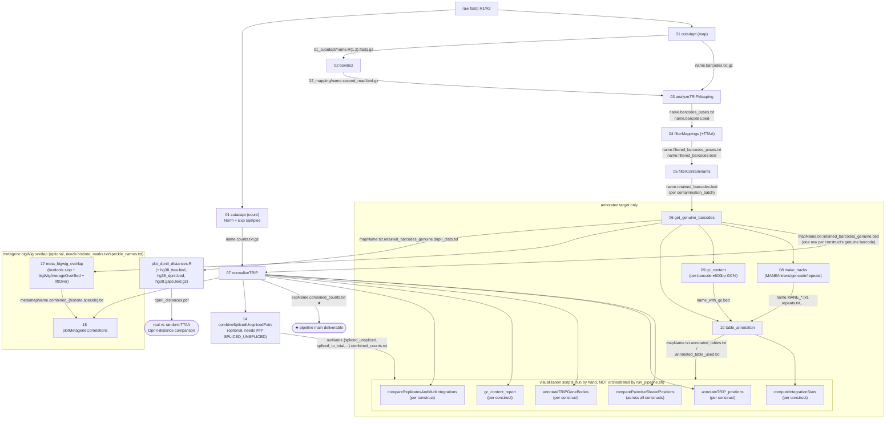

# trip-unified-pipeline

Config-driven TRIP primary-processing pipeline: raw paired fastq -> `combined_counts.txt`.

Built by merging igoru's own scripts with the partially-revised versions from
[ArtyomTyukaev/trip-pipeline](https://github.com/ArtyomTyukaev/trip-pipeline), resolving the two
open discrepancies between them (see below), and adding a single config file + orchestrator on top
so a run is driven by one text file instead of hand-written per-sample shell/bsub commands.

## Pipeline

```
raw fastq (R1/R2)
 -> [01] cutadapt (two-pass: barcode/UMI into read header, then read-through trim)
 -> [02] bowtie2 mapping -> second-read BED12                    (map-mode samples only)
 -> [03] analyzeTRIPMapping   -> <name>.barcodes_poses.txt / .barcodes.bed
 -> [04] filterMappings (+ optional TTAA filter) -> <name>.filtered_barcodes_poses.txt / .bed
 -> [05] filterContaminants   -> <name>.retained_barcodes_counts.txt / .bed
 -> [06] get_genuine_barcodes -> <mapName>.txt.retained_barcodes_genuine.bed   (one-to-many: combines replicate samples)
 -> [07] normalizeTRIP (+ optional 1-nt mismatch tolerance) -> <expName>.combined_counts.txt  ★
```

Background: a TRIP experiment transfects a pool of plasmids, each carrying a random
16- or 18-nt barcode next to a piggyBac reporter, so barcodes land at essentially random
genomic positions (`Map` libraries). The reporter's activity at each position is then read
out by sequencing the barcode alone from RNA or normalized DNA (`Norm`/`Exp` libraries).
Stages 01-06 are all about pinning down, per barcode, *where* it landed and *whether that
call can be trusted*; stage 07 is where a `Norm`/`Exp` pair actually gets turned into a
per-position expression value.

Barcode length is a real per-construct choice, not a fixed constant: `BARCODE_LEN` in
`### GLOBAL` (default 18) flows through to stage 01 (`--cut`/offset math), stage 03 (barcode
length filter), and stage 06 (barcode length filter) — set it to 16 for constructs that use
a 16-nt barcode. `effLength` in `### COMBOS` (stage 07) is a separate, per-combo setting for
how many of those bases the Norm/Exp readout actually uses, and can differ from
`BARCODE_LEN` itself.

### [01] cutadapt — `scripts/01_run_cutadapt.sh {map|count} <name>`

Extracts the UMI + barcode from R1's header into the read name (via cutadapt's `--rename`)
and trims the read-through/adapter sequence, so every later stage works off a clean,
position-tagged FASTQ instead of raw sequence.

- **`map` mode** (Map libraries — DNA, paired-end, R2 is genomic): two cutadapt passes.
  Pass 1 finds the R1 primer + `BARCODE_LEN` N's (barcode) + junction sequence with
  `--cut 4` first (strips the 4-nt UMI) and anchors R2 to the ITR primer that ends in the
  piggyBac `TTAA` duplication signature. Pass 2 trims any read-through into the construct
  from both mates. Output: `01_cutadapt/<name>.R{1,2}.fastq.gz` (R1 header carries
  `umi=`/`barcode=`) plus `<name>.barcodes.txt.gz` (read_name, UMI, barcode — one
  exactly-`BARCODE_LEN`-nt barcode per read).
- **`count` mode** (Norm/Exp libraries — barcode readout only, R2 unused downstream unless
  a per-row R2 adapter is set, see below): a single **anchored** (`-g "^..."`) cutadapt
  pass, then an awk one-liner tallies `barcode -> read_count` straight from the renamed
  FASTQ header, sorted by count descending. Output: `01_cutadapt/<name>.R{1,2}.fastq.gz` and
  `<name>.counts.txt.gz`. See `docs/count_exp_reference.md` for the real per-sample job
  scripts this mode is a parameterised template of, and why the primer match is anchored.

  Some Norm/Exp libraries were sequenced with a construct-specific adapter instead of the
  standard one — real, confirmed usage: every IntronTRIP_combined/SON_combined Spliced/
  Unspliced readout additionally trims a construct-specific 5' adapter off R2 (verified
  against real per-sample bsub `.csh` scripts, e.g. `IntronTRIP_run2/
  TRIP_RNA_spliced_B3-6_1-1_S53.csh`). `### FASTQ_NORM`/`### FASTQ_SAMPLES` rows take two
  optional trailing columns, `r1_adapter`/`r2_adapter` (bare sequence, no `^`/`g:`/`G:` —
  the script adds the anchor), overriding the constructed default and adding a paired `-G`
  trim respectively; blank falls back to the existing R1-only default. See
  `config/introntrip_combined_config.txt`/`config/son_combined_config.txt` for real
  populated examples. Verified: with the override, stage 01 reproduces real production
  barcode counts byte-for-byte (`TRIP_RNA_spliced_B3-6_1-1_S53`, 417,081 barcodes, zero
  diff).

### [02] bowtie2 mapping — `scripts/02_run_bowtie2.sh <name>` (Map-mode only)

Aligns both mates end-to-end to hg38 (`bowtie2 -X 2000`), then keeps only read 2 (flag
`0x80`) — R1 is the constant reporter sequence whose barcode was already captured in stage
01, R2 is the genomic DNA flanking the integration site. Converts R2's alignments to one
BED12 line each, piping `samtools view -f 0x80` straight into `bedtools bamtobed -i stdin`
rather than writing an intermediate read-2-only BAM (nothing downstream reads a BAM, only
the BED). Output: `<name>.bam` (both mates, sorted+indexed) and
`02_mapping/<name>.second_read.bed.gz` (what stage 03 reads). This script is a
reconstruction — no per-sample script for this step survives in the run directories, so the
alignment was historically run ad hoc; treat the bowtie2 flags as authoritative, the
packaging as new.

### [03] analyzeTRIPMapping — `scripts/03_analyzeTRIPMapping.R <path> <path_to_mapping> <name> [barcodeLen]`

The core per-read-to-per-position collapse. Joins stage 01's barcode table to stage 02's
alignment BED by read name, drops alignments outside a sane length range (20-300 bp) and
any landing in the globin locus (a common plasmid-integration artefact region on chr11),
then groups reads by genomic position + strand and asks, per position: which barcode(s)
were actually seen there, and in what proportion? A position can have several barcode
"clusters" if some are just sequencing/PCR noise around the dominant one — the position is
kept only if noise doesn't swamp the signal (`screenFunc`: drop positions where too many
distinct barcodes each carry ≥1% of the max count). Two outputs, row-aligned to each other:
`<name>.barcodes_poses.txt` (position + strand + `barcode:count,...` list +
aggregate counts) and `<name>.barcodes.bed` (same positions in BED6 for genome browsers).
`barcodeLen` (4th arg, default 18 if omitted; `run_pipeline.sh` always passes `BARCODE_LEN`)
controls the exact-length filter applied to barcodes before they're kept.

Minus-strand position uses plain `Start = V3` (matching both igoru's own current
`analyzeTRIPMapping_uniform.R` and the original, unmodified `trip-pipeline` script). An
earlier version of this repo used `V3-1` instead, on the theory that BED end is exclusive
so `V3-1` is the "true last aligned base" — reverted after real-data TTAA verification
showed it was wrong; see stage 04 and "Resolved discrepancies" below.

### [04] filterMappings (+ optional TTAA filter) — `scripts/04_filterMappings_TTAA.R <path> <name> [ttaaFilter <ttaa_bed>]`

Resolves multiple nearby integration calls that are really the same physical integration
site read slightly differently. Per chromosome, positions are visited in order of
decreasing read support (`MaxCount`/`TopBarcode`, computed here from stage 03's barcode
list); a position is dropped as redundant if a stronger position is within 10 bp, has
≥4x its read count, and its dominant barcode is within edit distance 3 (a near-duplicate,
not a coincidence). Survivors are written out with the two new columns appended:
`<name>.filtered_barcodes_poses.txt` (11 columns — stage 03's 9 plus `MaxCount`/`TopBarcode`)
and `<name>.filtered_barcodes.bed`.

Optional **TTAA filter** (piggyBac integrates exclusively at `TTAA` sites, so a position
that isn't adjacent to a real genomic `TTAA` is very likely a mapping artefact): pass
`ttaaFilter <ttaa_bed_path>` (a 6-col BED like `hg38_ttaa.bed`) as extra args to require
each surviving position to sit exactly at a known TTAA (strand-aware offset: `+` strand
checks `V2-4`, `-` strand checks `V2`, matching stage 03's plain-`V3` convention). Off by
default; enabled pipeline-wide by setting `TTAA_BED` in `### GLOBAL`.

### [05] filterContaminants — `scripts/05_filterContaminants_uniform.R <path> <fileList> [contFactor]`

Removes index-hopping contamination between mapping libraries that were sequenced
together. Takes a fileList (`sample_name<TAB>group`, one row per Map-mode sample) and, per
`(Chr, Pos, Barcode)` key, compares each sample's read count against the *maximum* count
seen for that same key in any *other* group on the same list. A key survives if its own
count is within `contFactor` (default 10 via the unified pipeline's `CONT_FACTOR`, i.e.
≥1/10th) of that cross-group max, or if the
key was never observed outside its own group at all (kept, since there's nothing to compare
against). In the unified pipeline, `run_pipeline.sh` builds one fileList per
`contamination_batch` value (see "Production configs" below) rather than one global list,
since contamination can only happen between samples multiplexed on the same physical
sequencing run. Output: `<name>.retained_barcodes_counts.txt` and
`<name>.retained_barcodes.bed` (the two are filtered independently, since a bed row's `V4`
field can pack several barcode variants at one position — see the script's own comments for
a real row-misalignment bug this fixes over the simpler upstream version).

### [06] get_genuine_barcodes — `scripts/06_get_genuine_barcodes.R <path> <mapName>.txt [barcodeLen] [dpniiBedPath]`

Combines every replicate Map-mode sample belonging to one construct (every `### FASTQ_MAPS`
row sharing a `mapName`, e.g. `5ss_Map_rep1`+`5ss_Map_rep2` -> mapName `5ss`) into one
genuine-barcode map for that construct. Reads each sample's `.retained_barcodes.bed`,
re-aggregates by `(Chr, Start, End, Strand)` across ALL of them, and within each position collapses near-duplicate
barcodes (edit distance ≤2) into their dominant variant, summing counts. A barcode/position
pair is "genuine" if that barcode maps to exactly one position across the whole construct
(`retained_barcodes_genuine.bed`); barcodes seen at more than one position are split off
separately (`retained_barcodes_multimappers.bed`) rather than being silently kept or
dropped. `_forUCSC` variants are the same tables with scores capped at 1000 for genome
browser display. This is what stage 07 reads as its map of barcode -> genomic position.

This is igoru's `~/R/trip/IntronTrip/get_genuine_barcodes_IntronTRIP.R`, not the older
`get_genuine_barcodes_v2.R` this repo started with — same grouping/merge logic (including
its documented quirk where a barcode merged into an already-dropped one can lose its count;
kept intentionally, not changed here), but the per-position dedup is rewritten with
`tapply`/vectors instead of `aggregate()`-on-a-dataframe-per-position, which mattered at
real scale (~140k positions, profiled bottleneck). It also guards the optional 3rd
(`barcodeLen`) argument — the old version's unconditional `as.integer(myArgs[3])` silently
became `NA` when called with only 2 args, which silently zeroed out every position's output
with no error at all.

**DpnII distance.** For every genuine (singleton) position, also computes the distance to
the nearest DpnII site *downstream* of it (downstream relative to the integration's own
strand: `+` looks for the next site at a higher coordinate, `-` at a lower one), against
`DPNII_BED`/`dpniiBedPath` (default `/home/projects/ulitsky/igoru/data/human/hg38_dpnii.bed`
if not given — a Hi-C-style DpnII digest-fragment map, not a direct site list; site
positions are recovered as each fragment's start, excluding each chromosome's first
fragment, which starts at 0 as a chromosome-boundary artefact, not a real cut site). Written
to `<mapName>.txt.retained_barcodes_genuine.dnpII_dists.txt` (`chr, start, strand, barcode,
dpnII_dist`, with a header row — unlike this stage's other outputs, which are headerless
BED). Verified on a real 5ss construct: median downstream distance 179 bp, consistent with
the expected ~256 bp average genomic DpnII spacing (median of an exponential distance-to-
nearest-point-in-one-direction ≈ 0.69 × mean spacing ≈ 177 bp).

Compare against a random-genomic background with `scripts/plot_dpnII_distances.R
<path> <distFiles> <ttaaBedPath> <dpniiBedPath> <outPdf> [nSample=10000]` — samples
`nSample` random sites from the real hg38 TTAA reference (each given a random `+`/`-`
strand, since piggyBac has no inherent insertion-orientation preference), computes the same
downstream-DpnII-distance metric for each, and plots the two distributions (real vs random)
overlaid, at both linear (capped at the pooled 99th percentile) and log10 scale. `distFiles`
is a comma-separated list of `*.dnpII_dists.txt` filenames to pool into one histogram. On
the same real 5ss construct, the random-TTAA background's median was 308 bp vs the real
barcodes' 179 bp — real integration positions sit measurably closer to DpnII sites than
random genomic sites do, worth investigating further (e.g. a library-prep or mapping bias
toward reads near cut sites) rather than assuming it's expected.

### [07] normalizeTRIP (+ optional 1-nt mismatch tolerance) — `scripts/07_normalizeTRIP_MM.R <path> <path_norm> <mapName>.txt <normSample> <expSample> <effLength> <reverseComplement> [oneMismatch]`

The actual expression readout, run once per `### COMBOS` row. Loads the construct's genuine
barcode map (stage 06), the Norm library's barcode counts (stage 01 `count` mode, floored
at `minNormReads = 2`), and the Exp library's barcode counts, all truncated/aggregated to
the first `effLength` bases (some readouts use a shorter effective barcode than the
construct's full `BARCODE_LEN`). Keeps only barcodes that (a) map to exactly one genomic position and (b) are present
in both Norm and Exp, then writes one row per barcode: raw `norm`/`exp` counts plus the
mapped `Chr`/`Pos`/`Strand`. `reverseComplement` (`TRUE`/`FALSE`, per-combo in the config)
handles Exp libraries sequenced from the opposite strand of the barcode (e.g. some RNA
readouts). Output: `<expName>.combined_counts.txt` ★ (the pipeline's end product — per-
barcode norm/exp counts + position, ready for a `exp.norm = log2((1+exp)/(1+norm))`-style
downstream analysis) and `<expName>.bed`.

Optional **1-nt mismatch tolerance** (`oneMismatch` as the 8th arg, or a `yes` in the
config's `### COMBOS` 6th column): before intersecting with the genuine map, Norm/Exp
barcodes that are exactly one substitution away from a single genuine barcode (and not
ambiguous between two) are "snapped" onto it and their counts summed in — rescues reads
with a single sequencing error that would otherwise be silently dropped for not matching
any genuine barcode exactly. Off by default; exact-match behaviour is unchanged when the
flag is omitted.

### [08] make_tracks — `scripts/08_make_tracks_genuine_barcodes.sh <name_list.txt> <mane_bed> <mane_introns_bed> <gencode_noncoding_bed> <repeats_bed>`

Reference annotation, independent of stage 07 (only needs stage 06's genuine-barcode
maps). One `bedtools intersect` per (construct × reference track × strand orientation),
for every construct listed in `<name_list.txt>` (one `<mapName>.txt` per line — the same
format as the real production `names.complete_maps.txt`, and what the orchestrator builds
automatically from `### FASTQ_MAPS`'s distinct `mapName`s). Produces, per construct:
`<name>.MANE_all.txt`, `.MANE_exonic.txt`, `.MANE_all_antisense.txt`,
`.MANE_exonic_antisense.txt` (all against `mane_bed`, sense/antisense via `-s`/`-S`, exonic
via `-split`), `.MANE_introns_sense.txt`/`.MANE_introns_antisense.txt` (against
`mane_introns_bed`), `.gencode_noncoding_all.txt`, and `.repeats.txt` — all read by stage 10.

This is igoru's `make_tracks_genuine_barcodes.sh` verbatim, with its 4 previously-hardcoded
annotation bed paths turned into required arguments (config-driven `MANE_BED`,
`MANE_INTRONS_BED`, `GENCODE_NONCODING_BED`, `REPEATS_BED`) and `cat file | while read`
replaced with `while read < file` (same behaviour, one fewer process). Verified
byte-for-byte identical output against the original script on a real construct (5ss, 3292
genuine barcodes).

### [09] gc_content — `scripts/09_gc_content_single_genuine_barcodes.sh <name> <chrom_sizes> <genome_fasta>`

Run once **per construct** (unlike 08/10, which take the whole name-list at once) —
matches the original per-construct `bsub` usage. Slops each genuine barcode's position
±500bp (`bedtools slop`), extracts the flanking sequence (`bedtools getfasta`), computes
%GC per barcode, and writes `<name>_with_gc.bed` (stage 06's bed + a GC% column), which
stage 10 reads for `GC`/`GC_category` (Low/Average/High, ±1 SD from the construct's mean).

This is igoru's `gc_content_single_genuine_barcodes.sh`, with its 2 previously-hardcoded
reference paths turned into required arguments (config-driven `CHROM_SIZES`,
`GENOME_FASTA`) and the inline `ml BEDTools` dropped (this repo's convention: modules are
loaded once up front by the caller — see "Running" below — not re-loaded per stage script).
Verified byte-for-byte identical output against the original script.

### [10] table_annotation — `scripts/10_table_annotation_genuine_barcodes.R <path> <name_list.txt> [mane_bed] [mane_introns_bed] [gencode_noncoding_bed] [trans2gene] [mane_expression] [chromhmm_bed] [spin_bed] [norm_manifest]`

The per-construct annotation table later analysis scripts (e.g.
`annotateTRIP_positions_genuine_barcodes.R`, `compareReplicatesAndMultiIntegrations_uniform.R`)
read as `<mapName>.txt.annotated_tables.txt`. For every construct in `<name_list.txt>`,
joins stage 06's genuine-barcode bed with stage 08's MANE/intron/gencode/repeats tracks and
stage 09's GC content, then adds: host-gene identity/expression (sense + antisense, exonic
+ intronic, normalized to K562 RNA-seq via `trans2gene`/`mane_expression`), distance-to-
TSS/TES/intron-boundary and relative position within the host feature, and two independent
chromatin-state annotations per position — ENCODE ChromHMM (`chromhmm_bed`) and SPIN
nuclear-compartment state (`spin_bed`).

This is igoru's `table_annotation_genuine_barcodes.R`, with its 7 previously-hardcoded
annotation paths turned into optional CLI args (each keeps its original hardcoded path as
a default when omitted, same length-guarded pattern as stage 06's `barcodeLen`/
`dpniiBedPath`) so the config drives them instead — behaviour is otherwise unchanged
(including a commented-out, never-active linear-regression residuals block from the
original, removed here as dead code rather than ported). Verified byte-for-byte identical
output against the original script on a real construct.

**`annotated_table_used.txt` (added 2026-08-03):** when `norm_manifest` (10th, optional
arg — a `mapName<TAB>normSample` TSV, one row per distinct `### COMBOS` pair;
`run_pipeline.sh` builds it automatically from `### COMBOS`' 1st+2nd columns) is given,
each construct also gets `<mapName>.txt.annotated_table_used.txt` — the same table
restricted to barcodes with ≥2 total normalization reads summed across every distinct
normSample used for that construct (each normSample counted once, even though it typically
appears in many `### COMBOS` rows — one per expSample sharing it). This is a stricter,
pooled-across-reps version of stage 07's own per-row `minNormReads=2` filter (which only
ever checks one normSample at a time), meant to answer "was this barcode actually
detectable in the normalization library" rather than "did stage 06 keep this barcode at
all." `comparePairwiseSharedPositions_uniform.R` and `computeIntegrationStats.R` (see
"Visualization scripts" below) read this filtered file instead of the unfiltered one.

### [14] combineSplicedUnsplicedPairs — `scripts/14_combineSplicedUnsplicedPairs_uniform.R <path>`

Optional, only runs (for both `combined_counts` and `annotated` targets) if `### SPLICED_UNSPLICED`
has rows — unlike stages 08-13, it depends on stage 07's `combined_counts.txt`, so
`run_pipeline.sh` runs it right after stage 07 rather than gating it to `annotated`. For each
`### SPLICED_UNSPLICED` row (`outName`, `splicedExpName`, `unsplicedExpName`, `totalExpName`),
loads the three named `combined_counts.txt` files (already-computed stage 07 outputs for a
spliced/unspliced/total RNA readout triplet of the same construct — same barcode/position rows
since they share the same map/norm) and derives three splicing-ratio tables:
`<outName>.spliced_unspliced.combined_counts.txt` (`exp.log10 = spliced/(spliced+unspliced)`,
`NA` if that sum is <20), `<outName>.spliced_to_total.combined_counts.txt` (rows with
`spliced+total>=10` kept, `exp.log10 = spliced/(spliced+total)`, `NA` if <20), and
`<outName>.spliced_and_unspliced_to_total.combined_counts.txt` (further filtered to
`spliced+unspliced+total>=10`, `exp.log10 = (spliced+unspliced)/(spliced+unspliced+total)`).

This is igoru's `~/R/trip/IntronTrip/combineSplicedUnsplicedPairs_uniform.R` verbatim, no logic
changes. `run_pipeline.sh` writes the section's rows out as a real `spliced_unspliced.txt` in
the working directory (the one positional arg the original script expects) before calling it.
See `config/introntrip_combined_config.txt` for a populated real example (16 rows, derived
verbatim from `IntronTRIP_combined/spliced_unspliced.txt`, including its 5 commented-out rows
preserved as `#` comments) and `config/son_combined_spliced_unspliced.txt` for the real
`SON_combined` triplets — kept standalone rather than embedded in a full config, since
`SON_combined` doesn't have a `### FASTQ_MAPS`/`### COMBOS`-style config in this repo yet.

### [17] meta_bigwig_overlap — `scripts/17_meta_bigwig_overlap.sh <mapTypesFile> <histoneBwDir> <speckleDir> <chromSizes> <chainHg38ToHg19>`

Optional (only runs if `histone_marks.txt` and `speckle_names.txt` — real, curated per-dataset
track lists, e.g. `single_combined/histone_marks.txt` — are both present in the working
directory; skipped entirely otherwise). For each `### FASTQ_MAPS` construct: `bedtools slop -b 50`
around every genuine barcode position (stage 06), `bigWigAverageOverBed` against every ENCODE
K562 histone-mark/factor bigWig (hg38, column 5/`mean0` of the raw output is what's kept),
`liftOver` the same regions to hg19, then `bigWigAverageOverBed` again against every
speckle/TSA-seq bigWig (hg19-native tracks). Combines each track's per-barcode column into one
matrix per construct (`meta/<mapName>.combined_{histone,speckle}.txt`).

Sequential port of the real `meta_histone_all.csh`/`meta_histone_summary.sh`/
`meta_speckle_all.csh`/`meta_speckle_summary.sh` (`single_combined/*.csh`/`*.sh`) — same
commands, run one after another instead of each `bigWigAverageOverBed` call being its own async
`bsub` job with LSF job-ID dependency tracking. Verified: the "combine into a matrix" step
reproduces the real `5ss.combined_histone.txt`/`5ss.combined_speckle.txt` byte-for-byte from the
real, already-computed `.tab.gz` files. Heavy at production scale (many tracks × many
constructs) — wrap in `bsub` yourself for a real run rather than running on a login node, same
as stages 01-02.

### [18] plotMetageneCorrelations — `scripts/18_plotMetageneCorrelations_uniform.R <path> <corType> <mapTypesList> <expFile> <outName>`

Correlates each barcode's summed expression (`log10(1+exp)`, no norm — a separate, simpler
readout than `### COMBOS`/stage 07, driven by its own `<mapType><TAB><exp>` `expFile`, reused
here from `run_pipeline.sh`'s own auto-generated `### COMBOS`-derived one) against every histone-mark and speckle/TSA-seq
track's stage 17 metagene signal. Per-construct bar charts (one per track type) plus a combined
heatmap across every construct and every track, `corType` correlation (`pearson`/`spearman`),
p<0.05 cells annotated with their p-value, color scale symmetric around 0 and shared between
the histone and speckle heatmaps.

This is igoru's `~/R/trip/plotMetageneCorrelations_singleCombined.R` verbatim, no logic changes.

### Visualization/QC scripts (formerly stages 11-13/15-16)

`comparePairwiseSharedPositions`, `annotateTRIP_positions`, `annotateTRIPGeneBodies`,
`gc_content_report`, and `compareReplicatesAndMultiIntegrations` all read stage 07/10's
output but aren't run by `run_pipeline.sh` -- they're QC/plotting scripts you run by hand
against however much of the pipeline you've already produced, not steps every run needs.
See the "Visualization scripts" section below.

## Visualization scripts

Not pipeline stages — standalone plotting/reporting scripts run by hand against
already-produced stage output (typically stage 07/10), not wired into `run_pipeline.sh`.
This includes five scripts that predate the numbered-stage/visualization-script split
(`comparePairwiseSharedPositions_uniform.R`, `annotateTRIP_positions_genuine_barcodes.R`,
`annotateTRIPGeneBodies_genuine_barcodes.R`, `gc_content_genuine_barcodes.R`,
`compareReplicatesAndMultiIntegrations_uniform.R` — dropped their numeric prefix and
`run_pipeline.sh` wiring accordingly) alongside the scripts written directly as
visualization scripts.

### plotSplicingEfficiencies — `scripts/plotSplicingEfficiencies_uniform.R <path> <expListFile> <outFile.pdf>`

Per-construct splicing-efficiency violin plot: for each `expListFile` row, the distribution
of per-position splicing efficiency (`exp.log10`, restricted to `[0,1]`) across barcodes.
`expListFile` is `expName<TAB>niceName<TAB>nameMap.txt`, one row per violin **in display
order** (no automatic reordering, unlike the original script's grep-based construct sort —
put rows in the file in the order you want them plotted; two rows sharing a `niceName` are
pooled into one violin). `expName.combined_counts.txt` must already carry its own `exp.log10`
(a `[0,1]`-bounded splicing ratio — stage 14's `*.spliced_unspliced.combined_counts.txt` is
the usual source); `nameMap.txt` is a construct's stage 10 `annotated_tables.txt`, read once
and reused across rows that share it. Colors are dynamic by violin position (1-2 gray, 3-6
alternating light/dark blue, 7+ a red gradient) rather than hardcoded to a fixed sample count.

This is a rewrite of igoru's `~/R/trip/IntronTrip/plotSplicingEfficiencies.R`. That script
read `<name>.annotated_tables.txt` directly for `exp.log10`, which only worked for one legacy
directory (`IntronTRIP_combined2`) where `table_annotation.R` had been run a second time per
splicing-derived experiment, baking `exp`/`exp.log10` straight into `annotated_tables.txt` — a
different, non-standard layout from the rest of this pipeline (construct-level
`<mapName>.txt.annotated_tables.txt` with no `exp` columns, merged downstream against
`<expName>.combined_counts.txt` by each analysis script). Rewired onto that same standard
merge instead (same `exp.log10`-preexisting guard and LP-style `map_barcode` handling as
`annotateTRIP_positions_genuine_barcodes.R`), so it works against
`IntronTRIP_combined`/`SON_combined`-shaped data. Also dropped:
an unrelated, broken "GC by intron" `ggplot` block (referenced an undefined `dfShow`, would
have errored on execution — a copy-paste leftover from a different script) and an
`n_samples <- nrow(dfShow)` line that would have crashed the same way before reaching the
real violin plot; the dynamic (rather than hardcoded-to-16) sample-count color logic the
original's own comment already called for is restored, using the actual number of violins.
Verified against real `IntronTRIP_combined` data (`A1`/`B3-6`, 2 reps each): the merge
reproduces the correct bounded-`[0,1]` `exp.log10` distribution and the script renders a
4-violin PDF with no errors.

### comparePairwiseSharedPositions — `scripts/comparePairwiseSharedPositions_uniform.R <path> <mapName1,mapName2,...> <expListFile> <outFile.pdf> [titleExtra]`

For every **pair** of mapping libraries (every distinct `### FASTQ_MAPS` `mapName`, not
every `### COMBOS` row — a QC/comparison step across constructs, not a per-readout one):
how many genomic positions are shared between the two (both have ≥1 barcode mapped
there), split into positions that also share an *identical* barcode (much stronger
evidence of a true shared integration than merely landing on the same position
independently) vs. ones that don't — plus, for the shared positions, the Spearman
correlation of the two libraries' per-position average `exp.log10`/`map`/`norm`, split the
same way. `expListFile` is `<mapName><TAB><expName>` (one row per construct × expression
library, pooled into that construct's per-position average) — see `examples/exp_lists/`
for real ones (including two from a separate splicing-ratio pipeline, which this script
auto-detects and handles correctly — see its own comments). Output: 4 `ComplexHeatmap`s
(shared-position counts; Spearman rho for `exp.log10`/`map`/`norm` each) in one PDF, plus
one `<outFile>.shared_positions.<mapA>_vs_<mapB>.txt` per unordered construct pair listing
every shared position, its shared barcode(s) if any, and both constructs' per-position
average values.

No hardcoded paths in this script (unlike 08-10) — reads only stage 07/10's own output,
specifically `<mapName>.txt.annotated_table_used.txt` (stage 10's normalization-filtered
table, not the unfiltered `annotated_tables.txt`) as of 2026-08-03. Build your own
`<mapName><TAB><expName>` `expListFile` from `### COMBOS`' `mapName`+`expSample` columns,
or use a hand-curated one directly — see `examples/exp_lists/` for real ones (real
production `expListFile`s are often not 1:1 with `### COMBOS`). Verified: the ported
script is byte-identical (beyond an added doc header) to the version already validated on
real `single_combined`/`SON_combined`/`IntronTRIP_combined` data.

### annotateTRIP_positions — `scripts/annotateTRIP_positions_genuine_barcodes.R <path> <mapName>.txt <namesExp_file> <outFile.pdf>`

Per-construct QC report, run once **per** `### FASTQ_MAPS` `mapName` (unlike
`comparePairwiseSharedPositions_uniform.R`'s whole-list call): `namesExp_file` is one
`<expName>` per line (not the `<mapName><TAB><expName>` pairs that script uses). For each
`<expName>` in the file, merges its `combined_counts.txt` against that construct's
`annotated_tables.txt` (stage 10), draws a barcode-overlap heatmap across libraries, then
per-library boxplots/cross-tabs of expression against ChromHMM and SPIN chromatin state.
Outputs the main PDF, a cross-library `.summary.pdf`, `.summary.txt`/`.counts.txt` (and
`_SPIN` equivalents), plus a per-`(library, state-type)` `.raw_ChromHMM.txt`/`.raw_SPIN.txt`
of the underlying (state, value) pairs, for pooling across an intron's replicates
elsewhere.

This is igoru's `annotateTRIP_positions_genuine_barcodes.R` verbatim, aside from an added
doc header and dropping one dead-code line (a `chromSizes` table loaded but never
referenced anywhere else in the script). No hardcoded external paths to extract — like
`comparePairwiseSharedPositions_uniform.R`, it only reads other pipeline stages' own
output. Verified byte-for-byte identical output (PDFs identical but for an embedded,
per-run creation timestamp) against the original script on real `single_combined` `5ss`
data.

### annotateTRIPGeneBodies — `scripts/annotateTRIPGeneBodies_genuine_barcodes.R <path> <mapName>.txt <namesExp_file> <outFile.pdf> [speckle_dir]`

Per-construct gene-body positional analysis, run once per `mapName` alongside
`annotateTRIP_positions_genuine_barcodes.R` (same `namesExp_file` format). For each
`<expName>`, correlates per-position expression against local GC content, host-gene-to-
nuclear-speckle distance, host gene expression (sense + antisense, exonic + intronic),
distance to TSS/TES/intron boundary, relative position within gene/intron, and intron
length — as both an `LSD::heatscatter` and a ggplot density-terrain scatter, each labelled
with its own Spearman rho/n/p. Outputs the main PDF plus a cross-library `summary.pdf`
(bar charts + heatmaps) and `.summary.txt`/`.counts.txt`/`.pvalue.xt` with the underlying
rho/n/p behind every correlation.

This is igoru's `annotateTRIPGeneBodies_genuine_barcodes.R` verbatim, aside from an added
doc header and its one hardcoded external path — the MANE-to-speckle-distance reference
directory — turned into an optional 5th CLI arg (`speckle_dir`, keeps the original
hardcoded path as default when omitted, same length-guarded pattern as stage 06's
`barcodeLen`/`dpniiBedPath`) so the config drives it instead. Verified byte-for-byte
identical output (PDFs identical but for an embedded, per-run creation timestamp) against
the original script on real `single_combined` `5ss` data.

### gc_content_report — `scripts/gc_content_genuine_barcodes.R <path> <mapName>.txt <namesExp_file> <outFile.pdf>`

Per-construct GC-content-vs-expression report, run once per `mapName` alongside
`annotateTRIP_positions_genuine_barcodes.R`/`annotateTRIPGeneBodies_genuine_barcodes.R`
(same `namesExp_file` format). For each `<expName>`: a GC% density histogram, an
expression-vs-GC% scatter colored by GC category (Low/Average/High, from
`annotated_tables.txt`'s `GC_category`), and an expression-by-GC-category boxplot with
pairwise t-tests between the three categories.

This is igoru's `gc_content_genuine_barcodes.R` verbatim, aside from an added doc header and one
real bug fix (applied to the original script directly too, matching stage 07/10's and
`annotateTRIP_positions_genuine_barcodes.R`'s/`annotateTRIPGeneBodies_genuine_barcodes.R`'s
equivalent merges): the unconditional `exp.log10 = log10(1+exp)` was silently overwriting the
pre-existing, differently-scaled `exp.log10` that `*.spliced_unspliced.combined_counts.txt` files
already carry (a `[0,1]`-bounded splicing ratio) — confirmed run in production against exactly
such files (a real `gc_content_IntronTRIP_spliced_unspliced.pdf` already on disk). Verified: with
the fix, merging a real `.spliced_unspliced.combined_counts.txt` keeps `exp.log10` bounded
`[0,1]` as expected (mean 0.495) instead of being overwritten with `log10(1+exp)` (which would
range up to 5.2 on the same data); byte-for-byte identical PDF output otherwise (aside from an
embedded per-run creation timestamp) against the original script on real `single_combined` `5ss`
data. No hardcoded external paths to extract — like the other four scripts above, it only reads
other pipeline stages' own output.

### compareReplicatesAndMultiIntegrations — `scripts/compareReplicatesAndMultiIntegrations_uniform.R <path> <mapName1,mapName2,...> <expListFile> <outFile.pdf>`

Per-construct QC, whole-list call like `comparePairwiseSharedPositions_uniform.R` (reuses
the same `<mapName><TAB><expName>` `expListFile` format). Asks: how well do independent
barcodes that land in the same gene, the same intron, or the exact same genomic position
agree in expression, compared to random barcode pairs? Barcodes-per-gene/intron/position
histograms, then expression-distance boxplots (random pairs vs. same gene-different-intron
vs. same intron vs. same position, each with Wilcoxon p-values) — near-duplicate barcodes
at one position are first collapsed by Hamming distance (<3), since those are more likely
PCR/sequencing error variants than independent integrations. Also an UpSet plot of which
barcodes are expressed (`exp.log10>0`) in which library.

This is igoru's `~/R/trip/compareReplicatesAndMultiIntegrations_uniform.R` verbatim, no logic
changes. Same hand-curated-`expListFile` caveat as `comparePairwiseSharedPositions_uniform.R` —
see `examples/exp_lists/IntronTRIP_combined.expression.exp_list.txt` for a real one (one `Total`
readout per rep per construct, not every `### COMBOS` expName).

### computeIntegrationStats — `scripts/computeIntegrationStats.R <xxx>` (reads `<xxx>.annotated_table_used.txt`)

Per-construct integration-landscape report: mean/median distance between consecutive
integrations on the same chromosome; how many MANE transcripts and how many GENCODE genes
have ≥1 integration (out of the total that exist); and a mutually-exclusive breakdown of
where integrations land — MANE intron > MANE exon > GENCODE exon (non-MANE) > GENCODE
intron (non-MANE) > antisense to a MANE transcript > other/intergenic, in that priority
order — rendered as a labelled pie chart (`plots/<xxx>.integration_categories_pie.pdf`, every
slice labelled with its category/%/n directly via `ggrepel`, no separate legend). MANE
intron/exon calls reuse stage 10's own `MANE_intron`/`MANE_exonic` columns; GENCODE
exon/intron calls are computed fresh via a sense-strand interval join against the full
GENCODE v42 exon/intron annotation (covers every transcript including the MANE-select
ones, so it's also the single, self-consistent gene set used for the "GENCODE genes hit"
denominator, rather than mixing MANE's RefSeq IDs with GENCODE's Ensembl IDs). The pie is
built with `ggforce::geom_arc_bar` (plain Cartesian wedge polygons) rather than the more
common `coord_polar()+geom_col`, since `ggrepel`'s repelling/leader-line logic needs
Cartesian space to work in — this is what keeps small neighboring slices (e.g. "MANE
exon"/"GENCODE exon (non-MANE)", often just ~1% each) legible instead of overlapping
inside their own sliver.

Ported from `~/R/trip/computeIntegrationStats.R`, changed to read
`<xxx>.annotated_table_used.txt` (stage 10's normalization-filtered table — barcodes with
≥2 total normalization reads across every `### COMBOS` normSample for that construct)
instead of `<xxx>.annotated_tables.txt`, so the integration landscape reflects the same
barcode set the rest of a real analysis would use, not every barcode stage 06 ever kept.

## Data flow

How each stage's output feeds the next, as a visual recap of the stage-by-stage descriptions
above. `combined_counts` (default target) is stages 01-07 (+ 14 if `### SPLICED_UNSPLICED` has
rows); `annotated` adds 08-10, plus 17-18 if `histone_marks.txt`/`speckle_names.txt` are
present. The DpnII distance analysis and the visualization scripts (bottom subgraph — run by
hand against stage 07/10 output, not orchestrated by `run_pipeline.sh`) are side-branches off
stages 06/07/10, independent of everything else. Two of the six visualization scripts
(`comparePairwiseSharedPositions_uniform.R`, `computeIntegrationStats.R`) read stage 10's
normalization-filtered `annotated_table_used.txt`; the other four still read the unfiltered
`annotated_tables.txt`.



## Running

```bash
ml R/4.3.1-foss-2022b cutadapt/4.2-GCCcore-11.3.0 Bowtie2/2.5.1-GCC-11.3.0 \
   SAMtools/1.16.1-GCC-11.3.0 BEDTools/2.30.0-GCC-11.2.0

mkdir my_run && cd my_run
bash ../run_pipeline.sh ../config/example_config.txt combined_counts
```

`target` (2nd arg) controls how far to run: `cutadapt` | `mapping` | `genuine_barcodes` |
`combined_counts` (default — stages 01-07, the pipeline's main deliverable, plus stage 14 if
`### SPLICED_UNSPLICED` has rows) | `annotated` (stages 01-10/14/17/18, adds per-construct
`annotated_tables.txt`/`annotated_table_used.txt`, plus — only if `histone_marks.txt`/
`speckle_names.txt` are present — a metagene histone-mark/speckle-track correlation report).
The pairwise-shared-position/per-construct-QC/gene-body/GC-content/replicate-agreement
reports (formerly stages 11-13/15-16) are visualization scripts, not part of any target —
see "Visualization scripts" above. Everything is written into the current directory. Every
stage that loops over independent items (samples/batches/constructs/`### COMBOS` rows)
submits one `bsub` job per item and blocks until that batch finishes before the next stage
starts (`USE_LSF=0` falls back to plain sequential local execution).

See `config/example_config.txt` for the config format:

- `### GLOBAL` — `key<TAB>value` pairs. Core: `BARCODE_LEN`, `BOWTIE2_INDEX`, `CONT_FACTOR`,
  `TTAA_BED`, `R1_PRIMER`, `R1_SUFFIX`, `R2_PRIMER`. Stages 08-10 (`annotated` target only,
  all shared cluster reference resources — safe to leave unset if you only need
  `combined_counts`): `MANE_BED`, `MANE_INTRONS_BED`, `GENCODE_NONCODING_BED`,
  `REPEATS_BED`, `CHROM_SIZES`, `GENOME_FASTA`, `TRANS2GENE`, `MANE_EXPRESSION`,
  `CHROMHMM_BED`, `SPIN_BED`. Stages 17-18 (`annotated` target, only if
  `histone_marks.txt`/`speckle_names.txt` are present): `SPECKLE_DIR`, `HISTONE_BW_DIR`,
  `HG38_TO_HG19_CHAIN`. Three of the smaller ones (`MANE_BED`, `CHROMHMM_BED`, `SPIN_BED`)
  are bundled directly in `reference/` for anyone without access to the Weizmann cluster's
  shared storage — see `reference/README.md`. The rest (`GENOME_FASTA`, `CHROM_SIZES`,
  `MANE_INTRONS_BED`, `GENCODE_NONCODING_BED`, `REPEATS_BED`, `TRANS2GENE`,
  `MANE_EXPRESSION`, `SPECKLE_DIR`, `HISTONE_BW_DIR`, `HG38_TO_HG19_CHAIN`) are too large or
  too environment-specific to bundle; point them at your own copies. The visualization
  scripts' own reference paths (e.g. `annotateTRIPGeneBodies_genuine_barcodes.R`'s
  `speckleDir`) are separate CLI args, not read from this config, since they aren't
  orchestrated by `run_pipeline.sh`.
- `### FASTQ_MAPS` — one row per Map-mode (DNA) fastq sample: `name, path_prefix, r1_suffix,
  r2_suffix, mapName, contamination_batch(optional)`. `mapName` is both which construct's genuine
  map this sample feeds into (stage 06) and its stage 05 contamination group — the two are the
  same concept here.
- `### FASTQ_NORM` — one row per Norm-mode fastq sample: `name, path_prefix, r1_suffix, r2_suffix,
  r1_adapter(optional), r2_adapter(optional)`. The last two override stage 01's default
  count-mode adapter per-sample — see stage 01 above.
- `### FASTQ_SAMPLES` — one row per Exp-mode fastq sample, same shape as `### FASTQ_NORM`; kept as
  a separate section purely so it's clear at a glance which samples are Norm vs Exp.
- `### COMBOS` — `mapName, normSample, expSample, effLength, reverseComplement,
  oneMismatch(optional)`, referencing names from the three sections above.
- `### SPLICED_UNSPLICED` — optional (stage 14 only): `outName, splicedExpName,
  unsplicedExpName, totalExpName`, all three referencing `### COMBOS`/`### FASTQ_SAMPLES`
  expNames. Omit the section entirely (or leave it empty) if you have no spliced/unspliced/
  total RNA readout triplets to combine.

Verified end-to-end on real (subsampled) data from stages 01 through 07.

## Production configs

- `config/single_combined_config.txt` — 4 constructs (5ss, CPA, 5ss_noP, CPA_noP): 12 Map + 8 Norm
  + 48 Exp samples, 48 combos. Derived verbatim from `single_combined/{5ss,CPA,5ss_noP,CPA_noP}.txt`
  + `combos.txt`.
- `config/introntrip_combined_config.txt` — 8 constructs (A1, B1, C1, D1, E1, H1, B3-6, B3-9):
  32 Map + 16 Norm + 48 Exp samples, 48 combos, plus a 16-row `### SPLICED_UNSPLICED` (stage
  14). Derived verbatim from `IntronTRIP_combined/{A1,...,B3-9}.txt` + `combos.txt` +
  `spliced_unspliced.txt`.
- `config/son_combined_config.txt` — 3 constructs (A1, B3-9, E1), a speckle knock-sideways
  (SON-FKBP/Protac) experiment: 12 Map + 6 Norm + 108 Exp samples, 108 combos, plus a 36-row
  `### SPLICED_UNSPLICED`. Derived verbatim from `SON_combined/{SON_A1,SON_B3_9,SON_E1}.txt` +
  `combos.txt` + `spliced_unspliced.txt`. All 12 Map samples are a single contamination batch
  (`LP_run1`), confirmed against the real `LP_run1/SON.txt` fileList. Fixed 2026-07-30: the
  real manifest `SON_combined/SON_B3_9.txt` was missing
  `Map_SON_B3_9_2_2_S70.retained_barcodes.bed` (present in `LP_run1`, the contamination
  fileList, and the otherwise-unreferenced alternate manifest `SON_B3.txt`, but dropped from
  `SON_B3_9.txt` itself) — added the missing line to the real file and to this config, so
  `SON_B3_9` is now all 4 real map samples, not 3.
- `config/son_combined_spliced_unspliced.txt` — superseded by the `### SPLICED_UNSPLICED`
  section in `son_combined_config.txt` above; kept only because it predates that config.

All three configs use the optional 6th `### FASTQ_MAPS` column, `contamination_batch`, so stage
05 runs filterContaminants once per real sequencing run (matching the historical
`run3.txt`/`run5.txt` / `IntronTRIP_run{2,3,4}.txt` / `LP_run1/SON.txt` fileLists) rather than
pooling every map sample across runs into one comparison — index-hopping contamination can only
happen between samples multiplexed together on the same flowcell.

See `docs/count_exp_reference.md` for the real historical `cut_norm.csh`/`count_exp.csh` commands
that stage 01's `count` mode is a parameterised template of.

All three configs also set `DPNII_BED` (see stage 06 above) to the real hg38 DpnII digest map.

## Resolved from the two repos' open discrepancies

1. **Stage 03 `barcodes_poses.txt` column count.** ~~Kept the alignment-`Length` column (10 cols
   from stage 03, 12 after stage 04 adds `MaxCount`/`TopBarcode`)~~ — **also retracted.** Length
   was originally kept to match `ArtyomTyukaev/trip-pipeline`'s version, but it isn't just an extra
   informational column: it was also added to stage 03's position-clustering `aggregate()` grouping
   (`by = chrom, Start, strand, Length` instead of `chrom, Start, strand`), which changes what counts
   as "the same position" — two reads at the same position+strand but different alignment length
   became separate groups. igoru's own `analyzeTRIPMapping_uniform.R` never had this column, and
   position+strand (no length, no barcode) is enough to define a group. Dropped entirely: stage 03 no
   longer computes or groups by `Length`, and stage 05 is back to its original 9/11-column
   expectation (`Barcodes` col 9, `MaxCount` col 10) matching `ArtyomTyukaev/trip-pipeline`'s
   unmodified stage 05 too.
2. **`analyzeTRIPMapping` minus-strand position.** ~~An earlier version of this repo used
   `Start = V3-1` instead of `V3` for `-`-strand alignments~~ — **retracted.** That change (and the
   matching `tt = Start+1` in stage 04) was verified only by internal self-consistency, not against
   real production data, and turned out to be wrong: cross-checked directly against real,
   already-computed `.barcodes.bed` files (`run3/5ss_Map_rep1_S81`, `run3/CPA_Map_rep3_S80`) and the
   real hg38 TTAA reference, plain `V3`/`tt = Start` gives a ~58-70% minus-strand TTAA hit rate
   (matching the `+`-strand baseline), while `V3-1`/`tt = Start+1` collapses to ~1.6-1.9%. Both
   igoru's own `analyzeTRIPMapping_uniform.R` and the original, unmodified `trip-pipeline` script use
   plain `V3` — there was never an actual discrepancy here to resolve.

## Notable differences from `ArtyomTyukaev/trip-pipeline`

- Stage 05 here is built on igoru's current (more advanced) `filterContaminants_uniform.R`, which
  additionally fixes a real `.filtered_barcodes.bed` row-misalignment bug that Artyom's simpler copy
  doesn't have (see the script's own comments).
- Stage 05 now takes an optional 3rd CLI arg for `contFactor` so the config can drive it.
- Stage 06 uses igoru's `get_genuine_barcodes_IntronTRIP.R` (vectorized, faster at real scale,
  with a fixed argument-parsing bug) rather than Artyom's `get_genuine_barcodes_v2.R` copy — see
  its README section above.
